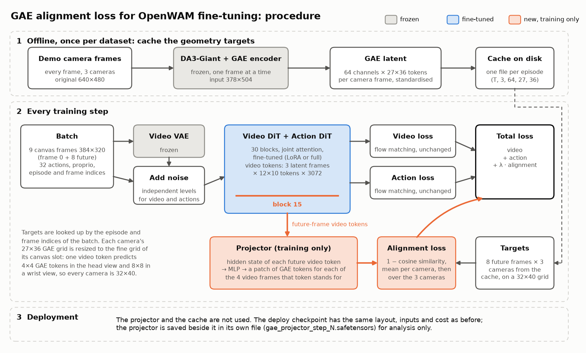

# GAE alignment loss for OpenWAM fine-tuning

A training-only loss that teaches the video branch of OpenWAM what the scene geometry will be in the
future frames. The hidden states of the future-frame video tokens after DiT block 15 are projected to
GAE (Geometric AutoEncoder) geometry latents and compared with the GAE latents of the ground-truth
future frames. Nothing changes at deployment.



## Why

In real-robot rollouts of `hang_ring` the model imagines the peg inside the ring when it is not
(all 12 insertion failures, and about half of the successes). The part of the imagined frame inside
the ring is inconsistent with the part above it, and GAE features carry that outside-to-inside
relation better than pixels or the video VAE latent (`outputs/geometry_phase0/analysis/`).
The loss gives the video tokens a direct geometry target for the future frames.

## Procedure

### 1. Cache the targets (once per dataset)

Every frame of every camera is encoded on its own with the frozen DA3-Giant + GAE-64 encoder, from
the original 640×480 image resized to 378×504. The posterior mean is standardised with GAE's latent
statistics and stored as float16.

| | |
|---|---|
| Script | `scripts/geometry/gae_cache.py` (conda env `gae`) |
| Output | `<cache>/episode_XXXXXX.npy`, shape `(T, 3, 64, 27, 36)`, cameras in the order head, left wrist, right wrist |
| Size | about 6.3 GB for `hang_ring` (16,863 frames × 3 cameras) |
| Time | about 25 minutes on two RTX A6000 |

The targets come from the camera images, not from the 384×320 training canvas, so a wrist view keeps
27×36 geometry tokens although it is only 4×5 video tokens in the canvas.

### 2. Train with the extra loss

For each training window (frame 0 plus 8 future frames, stride 4):

1. **Targets.** The dataset looks up the GAE latents of the 8 future frames by episode and frame
   index: `gae_target (8, 3, 64, 27, 36)` and `gae_valid (8,)`, which is false for frames past the
   end of the episode.
2. **Forward pass.** Unchanged. The block loop additionally keeps the video hidden states after
   block 15: `(B, 360, 3072)` = 3 latent frames × 12×10 tokens.
3. **Tokens.** Latent frame 0 is the clean first frame and is skipped. The two future latent frames
   are used; each stands for 4 video frames.
4. **Projector.** A 3-layer MLP maps every token to a patch of GAE tokens, once for each of the 4
   video frames the token stands for (a learned frame embedding selects the frame). A token in the
   head view predicts 4×4 GAE tokens and a token in a wrist view 8×8, so each camera is predicted
   on a 32×40 grid: `(B, 8, 3, 64, 32, 40)`.
5. **Loss.** The cached 27×36 grid of each camera is resized to 32×40 and compared with the
   prediction: `1 − cosine similarity` over the 64 channels. The loss is averaged inside each
   camera first, so the three cameras count equally.
6. **Total.** `loss = λ_video · video + λ_action · action + weight · align`.

Only video tokens are aligned. The action tokens are not, and the flow-matching losses are untouched.

### 3. Deploy

The projector is kept out of the deploy checkpoint, so a checkpoint trained with the loss loads and
runs exactly like one trained without it. No GAE model is needed at inference.

For later analysis the projector is saved in its own file next to each checkpoint:

```
outputs/openwam_checkpoints/<run>/<time>/
    checkpoint_step_5120.safetensors       deploy weights (unchanged key set)
    gae_projector_step_5120.safetensors    projector only, about 42 MB
```

The deploy, open-loop evaluation and fine-tune loaders only look for `checkpoint_step_*.safetensors`,
so they never read the projector file. It is pruned together with its checkpoint. To use it:

```python
from openwam.model.gae_align import load_projector
proj, info = load_projector("…/gae_projector_step_5120.safetensors", map_location="cuda")
# info: {"global_step": 5120, "align": {"layer": 15, "weight": 0.5, "loss": "cosine"}, ...}
pred = proj(tokens)  # tokens (B, 2, 12, 10, 3072): future-frame hidden states after block 15
                     # pred   (B, 8, 3, 64, 32, 40): GAE latents for 8 frames x 3 cameras
```

## Settings

`configs/train.yaml`, block `training.gae_align`; the cache path is `dataloader.gae_cache_dir`.

| Setting | Default | Meaning |
|---|---|---|
| `enabled` | `false` | Off by default; training is unchanged when off |
| `layer` | `15` | Hidden states after this many of the 30 DiT blocks |
| `weight` | `0.5` | Weight of the alignment term in the total loss |
| `loss` | `cosine` | `cosine`, `mse` or `cosine_mse`, on the standardised GAE latent |
| `hidden_dim` | `2048` | Projector width (about 21 M parameters) |

Why these defaults: block 15 is the best layer reported for this backbone by Relational Geometry
Forcing (arXiv 2610.29282); cosine is the standard choice in alignment work; 0.5 is the weight used
there and in REPA.

## Commands

```bash
# 1. cache (conda env gae); one process per GPU
CUDA_VISIBLE_DEVICES=0 python scripts/geometry/gae_cache.py \
    --dataset-dir assets/datasets/hang_ring --out assets/gae_cache/hang_ring --shard 0/2
CUDA_VISIBLE_DEVICES=1 python scripts/geometry/gae_cache.py \
    --dataset-dir assets/datasets/hang_ring --out assets/gae_cache/hang_ring --shard 1/2

# 2. fine-tune (conda env openwam)
GAE_ALIGN=1 LORA=1 bash scripts/train_hang_ring.sh
# variants: GAE_LAYER=10  GAE_LOSS=mse  GAE_WEIGHT=0.25  GAE_CACHE=/path/to/cache
```

The run is named `hang_ring_n50_delta_lora_gae15cosine`. The alignment loss is logged unweighted as
`train/loss_align` (0 = perfect, 1 = unrelated for the cosine loss).

## Where the code is

| File | Change |
|---|---|
| `scripts/geometry/gae_cache.py` | New. Writes the target cache |
| `openwam/model/gae_align.py` | New. Cache reader, projector, loss |
| `openwam/dataloader/bases/lerobot_v3_reader.py` | `gae_cache_dir` option; samples carry `gae_target` and `gae_valid` |
| `openwam/model/architectures/dual_system/mot_driver.py` | The block loop can keep the hidden states after chosen blocks |
| `openwam/model/architectures/base.py` | Creates the projector, computes the loss, keeps the projector out of the deploy checkpoint |
| `openwam/train/utils/checkpointing.py` | Writes `gae_projector_step_N.safetensors` beside each checkpoint and prunes it with its checkpoint |
| `openwam/train/openwam_trainer.py`, `openwam/train/utils/training_utils.py` | Switches the feature on, trains the projector under LoRA, logs `loss_align` |
| `configs/train.yaml`, `configs/dataloader/yam.yaml`, `scripts/train_hang_ring.sh` | Settings and the `GAE_ALIGN=1` switch |

Under LoRA the projector is added to the fully trained modules automatically. It trains at the base
learning rate.

## What has been checked

On the workstation (2 × RTX A6000), 16 Nov 2026:

- **Cache:** all 54 `hang_ring` episodes written, shapes and values checked (5.9 GB).
- **Projector layout:** each predicted location depends on exactly the token of its camera slot,
  position and latent frame (`tests/test_gae_align.py`).
- **Dataset:** a sample returns the cached latents of frames `start + 4 … start + 32`; frames past
  the episode end are masked.
- **Training, loss on:** a 20-step LoRA debug run (`outputs/logs/gae_align_smoke_loss_history.csv`).
  The projector is trained, `loss_align` starts at 1.00 and falls to 0.87 and 0.78 after the first two
  optimizer steps, and the total equals video + action + 0.5 · align.
- **Checkpoint:** the saved file has exactly the key set of the foundation checkpoint, with no
  projector and no LoRA keys.
- **Projector file** (17 Nov, a second 20-step debug run): `gae_projector_step_10` and `_20` were
  written beside the checkpoints (42 MB each). The unchanged deploy loader built the model from
  `checkpoint_step_20` and did not create a projector. With the saved step-20 projector attached to
  that deployed model, the alignment loss on 16 training windows is 0.786, matching the 0.78 logged
  in training; a freshly initialised projector gives 1.00.
- **Training, loss off:** the video and action losses of the first 8 steps are identical to the run
  with the loss on, and no alignment column is logged (`outputs/logs/gae_align_smoke_off_loss_history.csv`).

Not checked yet: a full 5,120-step run, loading a trained checkpoint in open-loop evaluation, and
any effect on imagination or task success.

Repository tests (17 Nov, `openwam` env, pytest 9.2): the CI suite (`make test`, GPU tests excluded)
gives 2,226 passed and 20 skipped; the GPU-marked tests give 59 passed and 22 skipped; the
train/deploy consistency and tri-system smoke tests give 44 passed and 1 skipped. Every skip is a
missing optional package (labtasker, matplotlib, cosmos_predict2) or missing model weights, not a
failure. `ruff check` passes on all files of this change.

## Limits of this first version

- It works for the YAM three-camera canvas (384×320) and the joint self-attention architecture only.
- Targets are single-frame GAE latents; their depth scale drifts from frame to frame in the wrist view.
- The loss is pointwise. A relational variant (matching token-to-token similarities, as in Relational
  Geometry Forcing) and a coarse-grid control are planned as further arms.
- Demonstrations only. Recorded rollouts are used for evaluation, not for training.

## How to judge a run

Before any robot run, replay the 72 recorded rollouts offline: run the new checkpoint on the logged
observation of every chunk and compare its imagination with what really happened, using the peg
measures in `outputs/geometry_phase0/analysis/peg_mismatch_analysis.py`. The run counts as working
if less peg is over-drawn inside the ring and video quality on the held-out demos does not drop.
